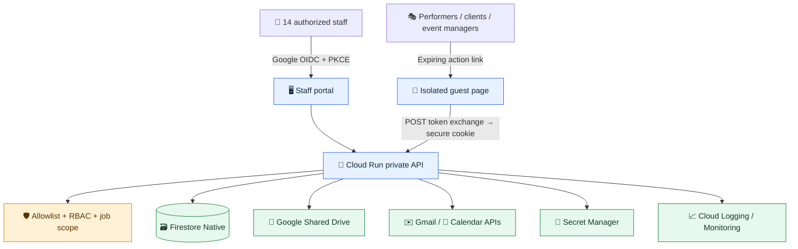
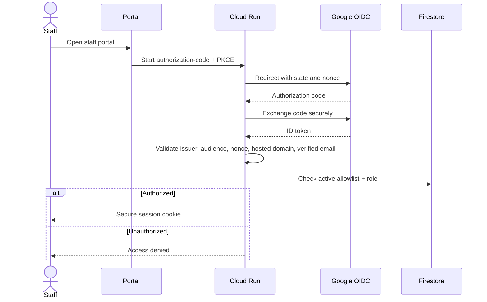
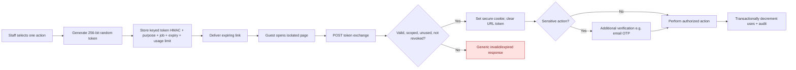
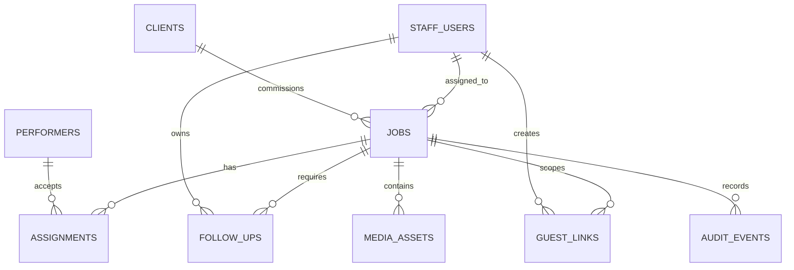
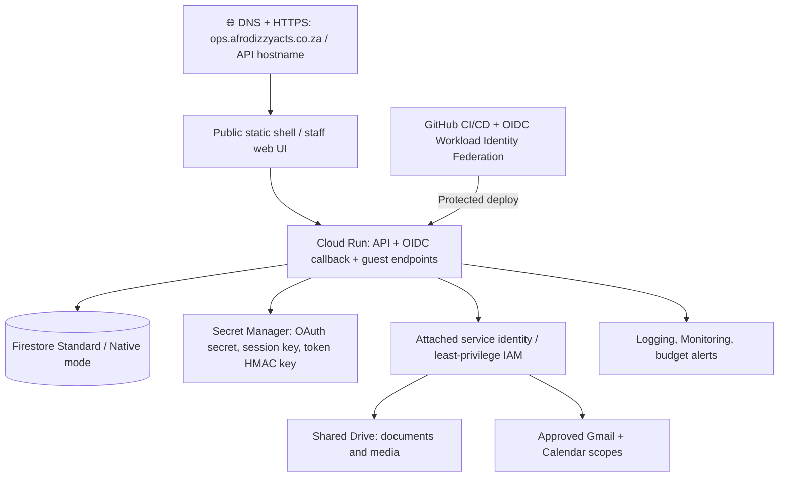
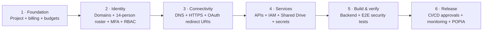
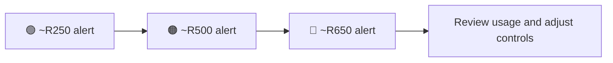

# DizzyOps — Production Architecture

> **Architecture blueprint · Not yet deployed**  
> **Identity:** 14 existing Google Workspace staff · **Guests:** secure, scoped, expiring links  
> **Cloud:** Google Cloud / `africa-south1` where available · **Planning envelope:** R650/month (not a hard cap)

## 1. Architecture at a glance

**Trust boundary:** GitHub Pages may host only a public static shell. Authentication, authorization, protected records, and all sensitive actions live on the Cloud Run backend.

## 2. Two distinct access paths

| | 🧑‍💼 Staff | 🎟️ Guest |
|---|---|---|
| Identity | Existing Google Workspace account | **No persistent account** |
| Entry | Google OIDC authorization code + PKCE | 256-bit CSPRNG token in a purpose-specific link |
| Authorization | Verified identity **plus** explicit allowlist and RBAC | Token purpose, job scope, recipient checks and remaining uses |
| Session | Secure backend session | POST exchange to HttpOnly / Secure / SameSite cookie |
| Visibility | Authorized staff functions and jobs | **One action on one job only** |
| Expiry | Session policy | Short TTL; revocable; one-time or limited-use |

### Staff sign-in sequence

> **Important:** Membership in the Workspace domain does **not** grant portal access. Enforce MFA in Workspace; never trust roles or ownership supplied by the browser.

### Guest link lifecycle

**Allowed guest actions:** confirm a job · submit availability · provide feedback · approve a quote · upload media · review an invoice (only with appropriate additional verification).

**Anti-abuse controls:** Never consume links on GET (mail scanners prefetch). Do not log raw tokens, include personal data in URLs, expose third-party scripts on guest pages, or deliver invoice/payment details via unverified bearer links. Use `Referrer-Policy: no-referrer`, `Cache-Control: no-store`, strict CSP, CSRF defenses, throttling, and transactional one-time-use enforcement.

## 3. Data model and relationships

| Collection | Core fields |
|---|---|
| `staff_users` | id, email, role, active, createdAt, lastLoginAt |
| `jobs` | id, clientId, eventAt, status, assignedStaffIds, createdAt, updatedAt |
| `assignments` | id, jobId, performerId, status, responseAt |
| `clients` | id, name, authorizedContacts, consent |
| `performers` | id, contact, specialties, complianceStatus |
| `follow_ups` | id, jobId, ownerStaffId, nextAction, dueAt, feedbackStatus, mediaStatus |
| `guest_links` | id, tokenHmac, jobId, purpose, recipientContactHash, expiresAt, usesRemaining, revokedAt, createdByStaffId |
| `media_assets` | id, jobId, driveFileId, uploaderType, rightsStatus, approvedAt |
| `audit_events` | id, actorType, actorId, jobId, action, timestamp, outcome |

*No seed data.* Generate IDs server-side; scope every query by authorized job/customer/organization. Enforce state transitions in transactions and validate file IDs, prices, and permissions on the server.

## 4. Infrastructure and security layers

**Never deploy:** service-account JSON keys, OAuth client secrets, admin tokens, or protected records to GitHub Pages or GitHub secrets when short-lived federation is available. Avoid broad domain-wide delegation unless specifically reviewed and justified.

## 5. Deployment gates

**Suggested project ID:** `afrodizzyacts-dizzyops-prod` (availability unconfirmed). Configure Cloud Run, Cloud Build, Artifact Registry, Firestore, Secret Manager, Cloud Logging, IAM, and only the Google APIs required. Configure Workspace Admin approval for OAuth scopes and API access. Define Shared Drive folders and retention. GitHub Pages custom-domain DNS is a separate step.

**Release-blocking tests:** expiry · revocation · reuse/race conditions · tenant/job isolation · unauthorized access · rate limits · CSRF · phishing resilience · upload/file scanning · auditable state transitions.

**POPIA review:** lawful basis · purpose limitation · data-subject rights · retention · breach response · auditability · cross-border processing.

## 6. Cost-control dashboard

| Lever | Initial setting / policy |
|---|---|
| Cloud Run | Min instances **0**, max **3**, request-based billing; tune concurrency from measurements |
| Database | Firestore Standard; lean indexes, bounded pagination, efficient reads, TTL cleanup |
| Media | Existing Workspace Shared Drive capacity, rather than bulk Cloud Storage |
| Avoid initially | Dedicated VMs, Cloud SQL, NAT, always-on load balancers |
| Operational limits | Capped upload sizes, request timeouts, controlled logs/retention and egress monitoring |

**R650/month is a planning envelope, not a spending limit.** Billing alerts do not stop charges; currency depends on the billing account. Review actual costs at **7, 30, and 90 days**.

## 7. Readiness snapshot

| Area | Status |
|---|---|
| Architecture and access design | 🟦 Blueprint documented |
| Google Cloud project and billing | ⬜ Pending |
| Workspace admin consent and staff roster | ⬜ Pending |
| DNS, production secrets and service identities | ⬜ Pending |
| Backend implementation and security testing | ⬜ Pending |
| Production rollout | ⛔ Not deployed |

> **Release rule:** Do not enable fake sign-in, simulated guest access, or production guest-link creation before the real backend, identity checks, and deployment gates are complete.

---

*Diagram rendering: GitHub supports Mermaid diagrams in Markdown. If a viewer does not support Mermaid, the accompanying tables and prose preserve the architecture.*
